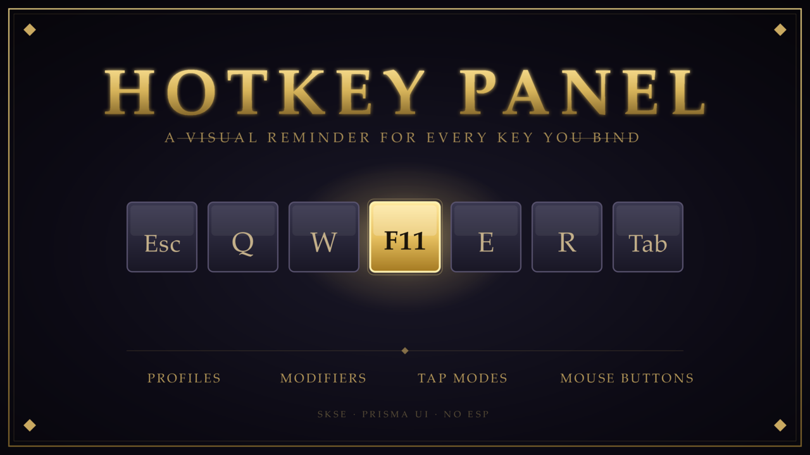

# Hotkey Panel

A keyboard and mouse overlay showing every hotkey of every mod. One key opens it.



## Features

- Full keyboard (main block, arrows, numpad) and a gaming mouse with its side buttons
- Mods' keys found on their own: MCM Helper menus, SKSE plugin ini / json files, mods that announce their keys
- Keys of mods that are not installed stay off the panel
- Clashes marked: two actions on one key get a red !
- Names, colours (colour wheel, see-through, saved colours), icons and borders per key
- Icon library: 130 pictures and 69 line icons, plus your own pictures (Icons folder)
- Mod profiles: one glowing outline round a mod's keys
- Modifier layers (Shift, Ctrl, any key) and tap modes (single, double, long press)
- Click a key to fire it in game
- MCM key picker: opens over an MCM that asks for a key; click the key there
- Move and resize from the title and the corner grip
- Tablet / phone remote over your home network
- Offline editor in Mod Organizer 2 (separate download)
- No ESP, no scripts, nothing in your save

## Requirements

- [SKSE64](https://skse.silverlock.org/)
- [Address Library for SKSE Plugins](https://www.nexusmods.com/skyrimspecialedition/mods/32444)
- [Magelight UI](https://www.nexusmods.com/skyrimspecialedition/mods/193303) 1.5.0 or newer
- [Microsoft Visual C++ Redistributable 2015-2022 (x64)](https://learn.microsoft.com/en-us/cpp/windows/latest-supported-vc-redist) (for Magelight UI)

Without Magelight UI the panel falls back to [PrismaUI](https://www.nexusmods.com/skyrimspecialedition/mods/100250).

Built for Skyrim SE 1.5.97, AE 1.6.x and 1.7.x. Tested on 1.6.1170.

## Install

Install with Mod Organizer 2 or Vortex. The installer asks one question:

- **Does your keyboard have G-keys?** Yes installs the G-keys add-on: F13-F24 become real keys in Skyrim for every mod
  (Skyrim stops at F12), and the panel gets a G-key column, G1-G6 = F19-F24. Set the G-keys to send those keys in the
  keyboard's own software (Logitech G HUB, Corsair iCUE, Razer Synapse and others). Another set-up: edit
  `js/gkeys.js` in `Magelight/HotkeyPanel/views` and `PrismaUI/views/HotkeyPanel`.

Default toggle key: **F11**. Settings in the panel changes it (Shift combinations work).

## Your own icons

Put PNG, JPG, SVG, WEBP or GIF pictures in a folder named **Icons** at the top of a mod (`Data\Icons`). Best a mod of
their own, so an update of Hotkey Panel never takes them away. Right-click a key > Icon and border > Your icons.

- Any file name: the name without its ending is the name in the list
- Folders inside Icons become groups
- Bigger than 256 pixels: shrunk to 256 for the panel (the file stays as it is)
- Up to 16 MB a file and 400 pictures
- A key remembers a picture by folder and file name

## Tablet / phone remote

Settings > Tablet / phone remote > Enabled. The row shows the address to open on the tablet
(`http://<your PC>:8950`, port editable). Any browser.

- Tap a key to fire it in game; long press for its menu. Edits sync both ways.
- Screen care for a tablet that stays on: the picture moves a few pixels now and then, and dims when nobody touches it
  (a tap fires the key and wakes it).
- Off by default. Answers devices on the local network only. The first time, Windows asks whether Skyrim may accept
  connections: allow it for your network.

## Offline editor (Mod Organizer 2)

Separate download. Copy the `HotkeyPanelEditor` folder into MO2's `plugins` folder and restart MO2. Tools >
Hotkey Panel - edit offline. Needs MO2 2.5+ and Edge or Chrome. Saves to `hotkeys.json` while Skyrim is closed.

## Files

- Settings and keys: `Data/SKSE/Plugins/HotkeyPanel/hotkeys.json` (a `.bak` is kept on every save)
- Log: `Documents/My Games/Skyrim Special Edition/SKSE/HotkeyPanelPrisma.log`

## Build from source

Visual Studio 2022 (C++), CMake 3.21+, vcpkg (`VCPKG_ROOT`).

```cmd
git clone --recursive https://github.com/StinkyPumpkin/HotkeyPanel.git
cd HotkeyPanel
build.bat
python tools\make_release.py
```

`build.bat` builds `HotkeyPanelPrisma.dll` and `GKeysInputBridge.dll` (CommonLibSSE-NG 9.1.0 from the
`extern/CommonLibSSE-NG` submodule); `build.bat deploy` also copies them into `%SKYRIM_MODS_FOLDER%`. The page is in
`dist/PrismaUI/views/HotkeyPanel` (`tools/deploy_views.py` copies it), the icon library is built by
`tools/build_icons.py`, the release zips by `tools/make_release.py`.

## Credits

- Magelight UI by Severause (MIT)
- PrismaUI
- CommonLibSSE-NG (alandtse and contributors)
- cpp-httplib by yhirose (MIT)
- SKSE team; meh321 and the Address Library maintainers

## License

GPL-3.0 (see LICENSE). Use, change and share it; versions you share stay GPL-3.0 with their source. Versions released before this change stay under the MIT licence they came with.
